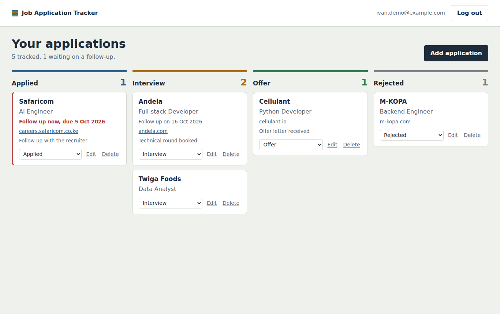
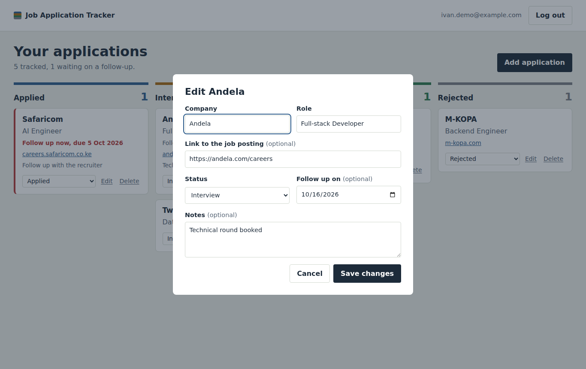
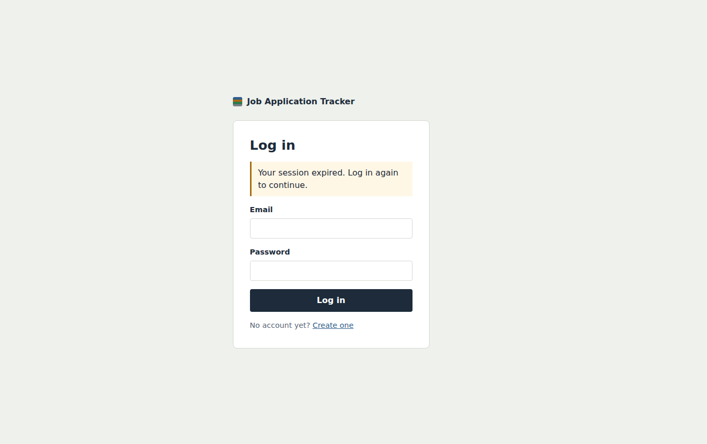
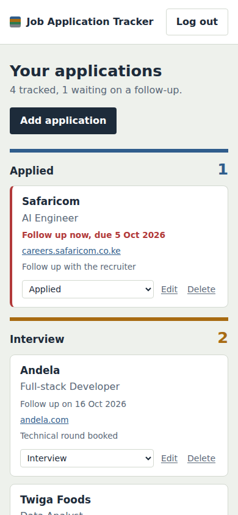
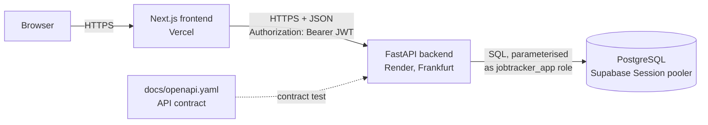

# Job Application Tracker

Keep every job application in one place. Add the company, role, link, status and a follow-up date, then see everything on a board grouped by status. Each user only ever sees their own applications.

**Live demo:** https://job-application-tracker-peach-kappa.vercel.app · **API health:** https://job-application-tracker-api-tzs1.onrender.com/health

> The API runs on Render's free tier, so the first request after a quiet period can take up to a minute.



## Features

- Create an account and log in (email and password, short-lived JWT)
- Add, edit and delete applications: company, role, job link, status, follow-up date, notes
- Board with four columns: Applied, Interview, Offer, Rejected
- Change status straight from a card
- Follow-ups that are due (today or overdue, and still Applied or Interview) are highlighted. The backend decides this, not the browser.
- Friendly error messages everywhere, including field-level validation errors from the API
- Works on mobile

## Screenshots

| Edit dialog | Session expired | Mobile |
|---|---|---|
|  |  |  |

## Tech stack

- **Backend:** Python 3.12, FastAPI, Pydantic v2, psycopg 3 (connection pool), PyJWT, Argon2 (argon2-cffi)
- **Frontend:** Next.js 15 (App Router), TypeScript, plain CSS
- **Database:** PostgreSQL on Supabase (Session pooler)
- **Hosting:** Render (backend, Frankfurt), Vercel (frontend)
- **Testing:** pytest against a real Postgres database; GitHub Actions CI

## Architecture



The frontend never touches the database. It only calls the backend, and the backend only returns JSON.

### How each architecture rule is applied

| Rule | Where it lives |
|---|---|
| Separation of layers | `frontend/src/lib/api.ts` is the only code that talks to the backend; the frontend has no DB driver or DB URL. The backend has no HTML routes. |
| API-first | `docs/openapi.yaml` was written first. `backend/tests/test_contract.py` fails if the app's routes, methods or status codes drift from it. |
| Single source of truth | All state is in Postgres. After every change the board reloads from the API instead of patching local state. `follow_up_due` is computed in `backend/app/applications_logic.py`. |
| Schema design | `db/schema.sql`: foreign key with `ON DELETE CASCADE`, `NOT NULL`, `UNIQUE` email, `CHECK` constraints on status, URL, lengths and lowercase email. Each index has a comment explaining it. |
| Validation at the boundary | `backend/app/schemas.py`: every body, path and query parameter is a Pydantic model or typed parameter (`extra="forbid"`, length limits, URL scheme check). All SQL is in `backend/app/repository.py` and uses `%s` parameters. |
| Stateless auth | `backend/app/security.py`: Argon2id password hashes, HS256 JWT with a 30-minute expiry, algorithm pinned on decode. See the token storage trade-off below. |
| Least privilege | The app connects as `jobtracker_app`: `SELECT, INSERT` on users, CRUD on applications, nothing else. It can't create, alter, drop or truncate (tested in `test_db_privileges.py`). Every application query includes `user_id = <id from token>`. Secrets live only in Render's env vars. |
| Graceful errors | `backend/app/errors.py`: one format, `{"error": {"code", "message", "details?"}}`. Unexpected errors are logged with a stack trace on the server and returned as a generic 500. |
| CORS and headers | `CORS_ORIGINS` env var, `*` rejected at startup. Backend sets `nosniff`, `X-Frame-Options: DENY`, a `frame-ancestors 'none'` CSP, `Referrer-Policy`, `Cache-Control: no-store`, and HSTS in production. The frontend sets a CSP in `next.config.ts`. |

### Token storage trade-off

The access token is kept in `sessionStorage` and sent in the `Authorization` header.

- **Why:** the frontend (Vercel) and backend (Render) are on different domains. Cookies across sites need `SameSite=None` and CSRF protection. A header-based token avoids CSRF completely, since browsers never attach it automatically.
- **The cost:** any JavaScript running on the page can read `sessionStorage`, so an XSS bug could steal the token. This is reduced by the CSP, React's escaping, the backend rejecting non-http(s) links, and the 30-minute expiry. `sessionStorage` (not `localStorage`) also clears when the tab closes.
- **The alternative:** an `HttpOnly` cookie can't be read by JavaScript at all. It's the stronger choice if both apps share a domain (e.g. `app.example.com` and `api.example.com`), at the cost of adding CSRF protection.

## Project structure

```
job-application-tracker/
├── backend/
│   ├── app/
│   │   ├── main.py               # app factory, middleware (headers, errors), CORS
│   │   ├── config.py             # settings from env vars, fail fast if missing
│   │   ├── db.py                 # connection pool
│   │   ├── security.py           # Argon2 hashing, JWT create/verify, auth dependency
│   │   ├── errors.py             # consistent JSON error format
│   │   ├── schemas.py            # Pydantic request/response models
│   │   ├── applications_logic.py # business rules (follow-up due)
│   │   ├── repository.py         # all SQL, parameterised, scoped by user_id
│   │   └── routers/              # auth.py, applications.py
│   ├── tests/                    # unit, API, DB-privilege and contract tests
│   ├── requirements.txt, requirements-dev.txt, pytest.ini, .env.example
├── frontend/
│   ├── src/app/                  # pages: login, register, board
│   ├── src/components/           # AuthForm, ApplicationCard, ApplicationDialog
│   ├── src/lib/                  # api.ts (only backend client), types.ts, format.ts
│   ├── next.config.ts            # Content-Security-Policy and headers
│   └── .env.example
├── db/schema.sql                 # tables, constraints, indexes, RLS, app role
├── docs/openapi.yaml             # API contract
├── docs/screenshots/
├── render.yaml                   # Render blueprint (backend)
└── .github/workflows/ci.yml      # tests + frontend build on every push
```

## Setup (Windows, PowerShell)

### 1. Database (Supabase)

1. In your Supabase project, open the SQL editor and run `db/schema.sql`.
2. In a **new, unsaved** query, set the app role's password:
   `ALTER ROLE jobtracker_app WITH PASSWORD '<long random password>';`
3. Click **Connect** and copy the **Session pooler** string. Change the username to `jobtracker_app.<project-ref>` and use the password from step 2.
4. Make sure the Data API is off (Project Settings > Data API). RLS is enabled by the schema.

### 2. Backend

```powershell
cd backend
python -m venv .venv
.\.venv\Scripts\Activate.ps1
pip install -r requirements-dev.txt
Copy-Item .env.example .env   # then fill in DATABASE_URL and JWT_SECRET
uvicorn app.main:create_app --factory --reload
```

API docs (development only): http://localhost:8000/docs

### 3. Frontend

```powershell
cd frontend
npm install
Copy-Item .env.example .env.local
npm run dev
```

Open http://localhost:3000.

### 4. Tests

```powershell
cd backend
.\.venv\Scripts\Activate.ps1
pytest -q
```

Without a test database, the unit, contract and security tests run (26) and the database tests are skipped. To run all 55, set `TEST_ADMIN_DATABASE_URL` to a **throwaway** local Postgres database whose name contains `test` (the tests drop and recreate the tables). GitHub Actions runs the full suite on every push.

## Deployment

- **Backend (Render):** New > Blueprint, pick this repo (uses `render.yaml`, Frankfurt). Set `DATABASE_URL`, `JWT_SECRET` and `CORS_ORIGINS` (your Vercel URL, no trailing slash) in the dashboard.
- **Frontend (Vercel):** import the repo, set Root Directory to `frontend`, add `NEXT_PUBLIC_API_URL` = your Render URL, deploy.
- After Vercel gives you a URL, update `CORS_ORIGINS` on Render to that exact URL.

## How it works

1. **Register:** the backend lowercases the email, hashes the password with Argon2id and inserts the user. A duplicate email returns 409.
2. **Log in:** the backend checks the hash and returns a JWT whose `sub` is the user id. A wrong email and a wrong password get the same message and similar timing.
3. **Every protected request:** the `get_current_user_id` dependency verifies the token and gives the route the user id. Routes never take a user id from the request body or URL.
4. **Ownership:** every application query has `WHERE ... AND user_id = %s`. Asking for someone else's application returns 404, so you can't even tell that it exists.
5. **Board:** the frontend fetches the list and groups it into columns for display. After any change it reloads from the API.

## Limitations

- No password reset, email verification or account deletion.
- No rate limiting on login or registration, so brute-force protection relies on Argon2's cost.
- No refresh tokens: after 30 minutes you log in again.
- The frontend CSP allows `'unsafe-inline'` scripts because Next.js needs it without a nonce setup.
- Render's free tier sleeps when idle, so the first request can take up to a minute.
- Ownership is enforced in the backend. RLS blocks the Data API roles, but it doesn't yet enforce per-user rows for the app role.

## Future improvements

- Rate limiting on auth endpoints
- Per-user RLS policies (`SET LOCAL app.user_id`) as defence in depth
- Drag-and-drop between columns
- Email reminders for follow-ups
- Nonce-based CSP
- Search and filtering by company or date

## License

MIT © Ivan Kipkorir. See [LICENSE](LICENSE).
